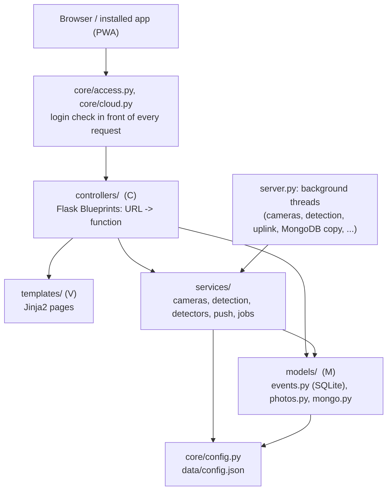

# OfficeEye architecture

**Name: Modular Monolith with Layered MVC (Controller → Service → Model) on
Flask Blueprints**, built by an **Application Factory** (`create_app()`).

- **Modular monolith:** one Python process (one deploy) holding two modules.
  - `officeeye/` is the camera app.
  - `netra/` is NetraAttend, the face recognition attendance. It is mounted at
    `/attendance`.
- **Layered MVC:** each request goes down the same layers.
  1. The **Controller** (a Flask Blueprint) takes the request.
  2. The **Service** does the work.
  3. The **Model** stores or reads the data.
  4. The page itself is a **View** (a Jinja2 template).
- **Stack:** Python 3.12, Flask, Jinja2, SQLite, MongoDB Atlas (copy), OpenCV
  and PyAV (cameras), Ultralytics YOLO (detection), a PWA (installed app and
  phone alerts).

## Layers



### What each layer may call

| Layer | Folder | Does | May call |
| --- | --- | --- | --- |
| Controller (C) | `officeeye/controllers/` | Reads the request and answers with a page or JSON. Holds no business logic. | services, models, core |
| View (V) | `officeeye/templates/`, `officeeye/static/` | HTML, CSS, JS and the PWA files. | only the JSON API, from the browser |
| Service | `officeeye/services/` | The work: camera streams, the detection pipeline, the detectors, phone alerts, background jobs. | models, core, other services |
| Model (M) | `officeeye/models/` | Stored data: the SQLite record log, photo files, the MongoDB copy. | core/config only |
| Core | `officeeye/core/` | Settings, the office login, the cloud view, the code version. | used by every layer |

## Folder layout

```
OfficeEye/
├── app.py                   start here: py -3.12 app.py  (like NestJS main.ts)
├── officeeye/               the camera app
│   ├── __init__.py          create_app(): application factory (like AppModule)
│   ├── server.py            start-up: one copy only, cameras, detection, jobs, web server
│   ├── controllers/         C: Flask Blueprints, one per part of the app
│   │   ├── dashboard.py     /, /api/status, /api/notices, /api/people/day
│   │   ├── live.py          /live, /frame/<cam>.jpg, /live/<cam> (video), /photos/...
│   │   ├── search.py        /search, /api/search, /api/search/ai
│   │   ├── restricted.py    /restricted, /api/alerts...
│   │   ├── records.py       /api/events, /api/records/delete
│   │   ├── running_time.py  /running-time, /api/running-time (+ CSV)
│   │   ├── phone.py  sleeping.py  night.py  parking.py  washroom.py  seats.py
│   │   ├── health.py  fire.py
│   │   ├── cameras.py       /cameras, /api/cameras/..., /api/scan
│   │   ├── settings.py      /settings, /api/office, /api/detection, /api/photos, /api/mongo
│   │   ├── push.py          /sw.js, /api/push/... (PWA, phone alerts)
│   │   ├── attendance.py    /attendance-app, mounts netra/ at /attendance
│   │   └── common.py        page(), day_arg(), HM (shared helpers)
│   ├── services/            the work (business logic, background threads)
│   │   ├── camera.py  cameras.py  rtsp.py  scan.py        cameras
│   │   ├── detection.py                                   shared YOLO model + scheduler (pipeline)
│   │   ├── washroom.py  sleeping.py  night.py  parking.py  seats.py   detectors on the pipeline
│   │   ├── fire.py  health.py  search.py                  their own checks
│   │   ├── push.py                                        phone alerts (Web Push)
│   │   ├── status.py  frames.py  housekeeping.py          live status, JPEG frames, clean-up / running time
│   │   └── sources.py                                     real cameras, or the cloud view's copies
│   ├── models/              M: stored data
│   │   ├── events.py        SQLite log: data/events.db
│   │   ├── photos.py        evidence photos: data/photos/
│   │   └── mongo.py         copy of the records in MongoDB (MONGO_URI in .env)
│   ├── core/
│   │   ├── config.py        settings: data/config.json
│   │   ├── access.py        office PC login: view / edit (guard on every request)
│   │   ├── cloud.py         cloud view (read-only copy) and the office uplink
│   │   └── version.py       code fingerprint: open pages reload on new code
│   ├── templates/           V: Jinja2 pages (base.html = sidebar layout)
│   └── static/              app.css, icons, manifest.webmanifest, sw.js
├── netra/                   NetraAttend module (attendance), its own Flask app at /attendance
│   ├── app.py  api.py       its controllers (pages, /api/v1)
│   ├── attendance.py  engine.py  faces.py  camera.py  backup.py   its services
│   ├── db.py                its model (MongoDB)
│   └── templates/  static/  its views
├── tools/                   training and maintenance scripts (not part of the running app)
├── deploy/                  VPS: Caddyfile, vps_install.sh
├── Dockerfile  docker-compose.yml  render.yaml  requirements.txt  run.bat
├── *.pt                     YOLO model files (not in git, downloaded)
└── data/                    config, records, photos (not in git, back it up)
```

## NestJS → this project

| NestJS | OfficeEye (Flask) |
| --- | --- |
| `main.ts` | `app.py` → `officeeye/server.py` |
| `AppModule` | `create_app()` in `officeeye/__init__.py` |
| `*.controller.ts` | `officeeye/controllers/*.py` (Blueprints) |
| `*.service.ts` | `officeeye/services/*.py` |
| entities / repositories | `officeeye/models/*.py` |
| Guards / middleware | `core/access.py`, `core/cloud.py` (`before_request`) |
| `ConfigModule` | `core/config.py` |
| views (hbs / ejs) | `officeeye/templates/` (Jinja2) |
| a separate feature module | `netra/` (mounted with DispatcherMiddleware) |

## One request, start to end

`GET /api/parking?day=2026-11-19`:

1. `core/access.py`'s gate checks that the user is logged in.
2. `controllers/parking.py` → `api_parking()` reads `day`.
3. `models/events.py` returns the parking records.
4. The JSON answer goes back to `templates/parking.html`, which draws it.

The vehicles themselves were found earlier, in the background:

1. `services/camera.py` decodes a frame.
2. `services/detection.py` runs YOLO on it.
3. `services/parking.py` waits until a vehicle stands still.
4. `models/events.py` and `models/photos.py` save the record and its photo.

## Adding a feature

1. **Detection logic:** a detector class in `officeeye/services/<feature>.py`.
   It registers itself with `pipeline.add(...)`. Import it in `server.py` with
   the others.
2. **Page and API:** a Blueprint in `officeeye/controllers/<feature>.py`. Add it
   to `blueprints()` in `controllers/__init__.py`.
3. **View:** `officeeye/templates/<feature>.html` (extends `base.html`), and a
   link in the sidebar of `base.html`.
4. **Settings:** defaults in `core/config.py` `DEFAULTS`.
